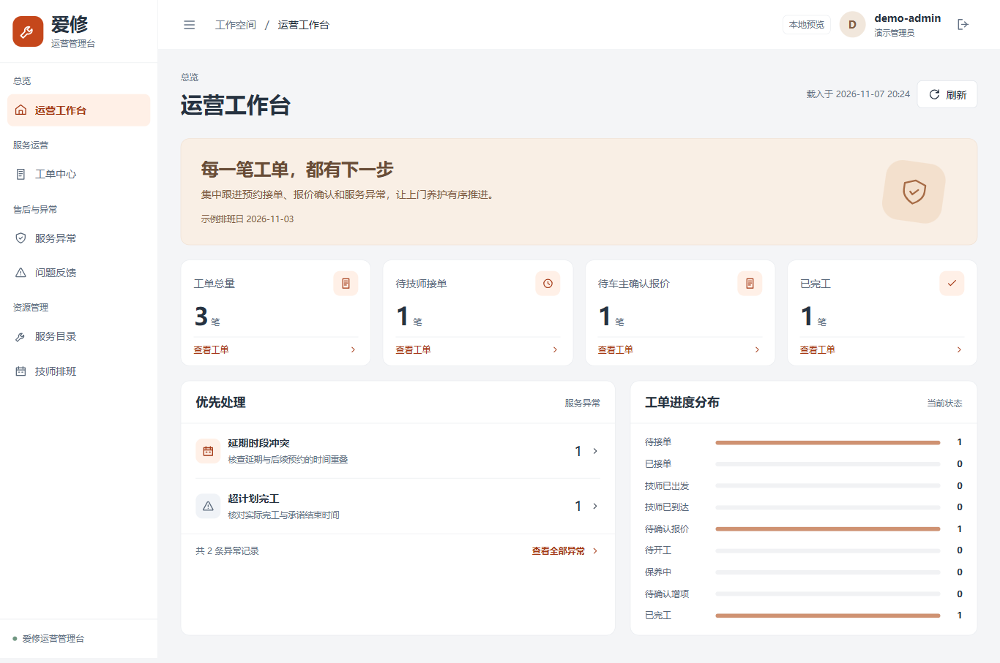
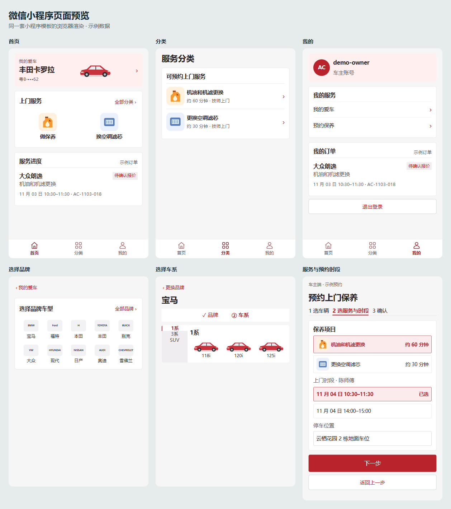
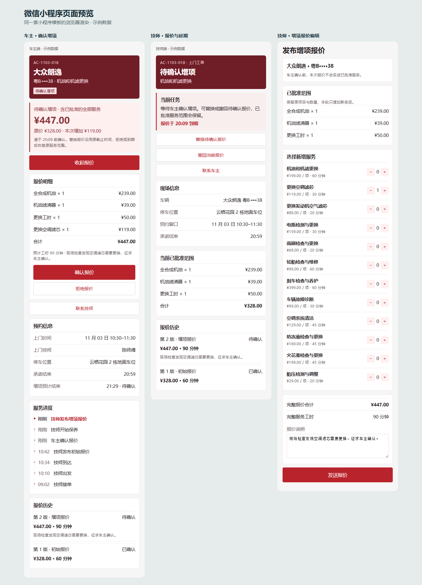

# 爱修 · 上门汽车保养平台

车主在微信小程序选择车辆、保养项目和上门时间。技师接单后发布报价，车主确认后开始保养，完工后由车主验收归档。运营人员通过 Vue 管理端查看工单和异常，维护服务目录、排班和账号。



<details>
<summary>查看小程序演示截图</summary>

车主首页、车辆选择与上门预约。画面使用演示数据。



车主确认增项、技师查看报价历史与编辑增项。画面使用演示数据。



</details>

## 功能

| 使用者 | 主要操作 |
| --- | --- |
| 车主 | 注册登录、维护车辆、组合预约、改期取消、确认或拒绝报价、验收归档 |
| 技师 | 接单拒单、更新上门进度、发布和替换报价、处理增项、撤回报价、申请延期和登记完工 |
| 管理员 | 工单与异常查询、目录定价、技师排班、角色调整与账号启停、知识资料管理 |

服务目录变动后，历史订单保留当时的价格和服务范围。预约和改期用数据库事务协调技师时段，报价确认校验版本、状态和有效期。AI 可以提取预约草稿和辅助解释报价，业务提交仍由对应角色确认。

当前为演示版。反馈、投诉和订单聊天使用独立演示流程，微信支付待接入。AI 知识库和报价分析需要配置向量服务及可用资料。

## 技术栈

- 后端使用 Java 21、Spring Boot 4、Spring Security、JWT、MyBatis、MySQL 8.4 和 Flyway。
- 管理端使用 Vue 3 和 Vite。车主端和技师端共用原生微信小程序，按登录角色进入各自的工作区。
- AI 使用 Spring AI 调用 DeepSeek。知识资料的原文存放在文件卷，Redis Stack 提供向量检索。

```text
backend/                     Maven 后端
├── auto-care-common/        公共契约、身份和错误类型
├── auto-care-ai/            模型、Embedding 和向量检索适配
├── auto-care-server/        业务 API、数据库迁移和测试
└── deploy/                  Dockerfile 和本地演示配置生成器
frontend/
├── admin-web/               Vue 管理端
└── mini-program/            车主和技师小程序
docs/screenshots/            演示截图
compose.yml                  本地后端、MySQL 和可选 Redis Stack
```

## 本地运行

需要 JDK 21、Maven 3.9、Docker Compose、Node.js 20 或 22，以及用于打开小程序的微信开发者工具。下列命令在仓库根目录的 Windows PowerShell 中执行。

### 1. 构建后端并启动 MySQL

```powershell
mvn -f backend/pom.xml -DskipTests clean package
.\backend\deploy\New-DemoEnv.ps1
docker compose up -d --build --wait
curl.exe -i http://127.0.0.1:18080/api/v1/me
```

Compose 为演示创建独立的 MySQL 数据卷。Flyway 启动时建表并写入演示账号。`/api/v1/me` 在未登录时预期返回 `401`。默认后端端口为 `18080`，如被占用，在本地 `.env` 改 `APP_HTTP_PORT`，并同步更新两个前端的 API 地址。

| 角色 | 本地演示账号 |
| --- | --- |
| 管理员 | `admin1` |
| 车主 | `owner1` |
| 技师 | `tech1` |

密码取自本机生成的 `.env` 中的 `AIXIU_DEMO_PASSWORD`。脚本为每次新演示环境生成随机密码和 JWT 密钥。`.env` 由 Git 忽略，原配置与 MySQL 数据卷配套使用。其他平台可以按 [.env.example](.env.example) 配置，`SEED_PASSWORD_HASH` 使用演示登录密码的 BCrypt（cost 10）哈希。

### 2. 启动 Vue 管理端

```powershell
cd frontend/admin-web
npm ci
npm run dev -- --open
```

打开 `http://127.0.0.1:5173/`，使用管理员账号登录。Vite 默认把 `/api/v1` 转发到 `127.0.0.1:18080`。如果更改了后端端口，启动前设置 `AIXIU_API_TARGET`，例如 `$env:AIXIU_API_TARGET='http://127.0.0.1:18081'`。

### 3. 打开微信小程序

用微信开发者工具导入 `frontend/mini-program`，按工具提示选择测试号或你自己的 AppID。本机模拟器使用 [data/config.js](frontend/mini-program/data/config.js) 的默认 API 地址 `http://127.0.0.1:18080`。开发者工具本地联调时可在「详情 → 本地设置」临时跳过请求域名校验。真机调试使用已注册的小程序 AppID 和设备可访问的地址。上线时给 `apiBase` 配置有效的 HTTPS 域名，并在微信公众平台登记 `request` 合法域名。

推荐演示路径为车主预约、技师接单并报价、车主确认、技师完工、车主验收，最后回到管理端查看工单。

### 4. 可选 AI 配置

预约草稿和 AI 对话共用聊天模型开关。在 `.env` 设置 `AUTOCARE_BOOKING_AI_ENABLED=true`，并在当前终端注入模型密钥后重建容器：

```powershell
$env:MODEL_API_KEY = [Net.NetworkCredential]::new('', (Read-Host '输入模型 API Key' -AsSecureString)).Password
docker compose up -d --no-build --force-recreate --wait app
```

默认模型为 `deepseek-flash`，也可在 `.env` 覆盖 `MODEL_BASE_URL` 与 `MODEL_NAME`。知识库额外需要启动 `docker compose --profile ai up -d --wait vector`，配置 `EMBEDDING_API_KEY` 与 Embedding 地址、模型和维度，并设置 `AUTOCARE_EMBEDDING_ENABLED=true`。启用报价分析时设置 `AUTOCARE_QUOTE_AI_ENABLED=true`，在管理端上传适用资料并等待索引完成后再试。

如果容器日志报 `UnknownHostException`，可先检查容器的域名解析。随仓库提供的 [DNS 覆盖文件](compose.dns.yml) 记录了本地联调使用的解析地址，确认当前网络可访问它们后，运行 `docker compose -f compose.yml -f compose.dns.yml up -d --no-build --force-recreate --wait app` 应用到后端容器。

### 更新与停止

- 修改 Java 后，重新执行 Maven 打包和 `docker compose up -d --build --wait app`。
- 修改运行配置后，使用 `docker compose up -d --no-build --force-recreate --wait app`。
- `docker compose logs --tail 50 app` 查看后端启动日志。
- `docker compose down` 停止本地演示，保留数据卷供下次启动使用。

## 验证入口

发布目录已用独立 Compose 环境从空库启动，并复测管理员目录改价、账号角色调整、车主预约、技师报价和增项、完工验收与管理端工单查询。AI 服务按各自的模型与向量配置单独验证。

- `npm --prefix frontend/admin-web run build` 构建管理端静态产物。
- 安装管理端依赖后，从仓库根目录运行 `node frontend/verify-mobile.cjs` 和 `node frontend/verify-d3.cjs`，回归小程序演示流程和报价边界。
- 后端测试位于 `backend/auto-care-server/src/test`。涉及数据库的集成测试使用独立测试库和测试凭据。
